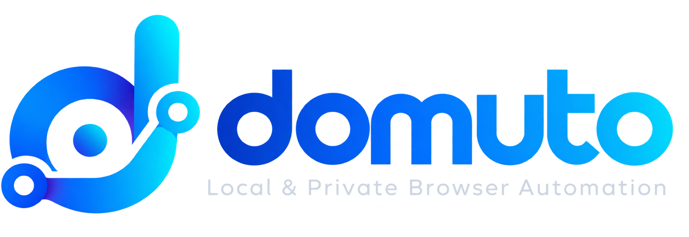

<div align="center">
  

  <h3>Visual Browser Automation & CSV Workflow Studio for Chrome (Manifest V3)</h3>

  <p>
    <b>Turn repetitive browser tasks into automated workflows. No coding required.</b><br/>
    Interactive on-page element picker · Multi-row CSV data engine · Conditional <code>IF / THEN / ELSE</code> branching · AI-ready workflow export/import · 100% local & privacy-first.
  </p>

  <p>
    
    
    
    
  </p>
</div>

---

## ✨ What is Domuto?

**Domuto** is a local, privacy-focused Chrome Extension (Manifest V3) that brings a **Google Tag Assistant–style visual element picker** and a **visual workflow sequencer** directly to any website.

Instead of writing brittle Puppeteer/Selenium scripts or paying for cloud RPA subscriptions that upload your data to remote servers, Domuto runs **entirely inside your browser**. Click elements on a live webpage to map steps, bind inputs to CSV columns, add `IF / THEN / ELSE` rules, and replay multi-page workflows across hundreds of CSV rows.

---

## 🚀 Key Features

### 🎯 1. Interactive On-Page Element Picker (Shadow DOM HUD)
- Launch any target domain and attach the floating **Domuto HUD** directly over the live page.
- Hover and click inputs, buttons, links, tables, and `<select>` dropdowns to automatically capture resilient CSS selectors.
- **Native `<select>` Option Extraction**: Clicking a dropdown automatically extracts all `<option>` values and labels into the HUD so you can pick the exact option without inspecting HTML.
- **Shadow DOM Isolation**: The on-page HUD runs inside an isolated Shadow root so its styles never collide with the host website.

### 📊 2. CSV-Driven Multi-Row Sequencer
- Upload a **Master Reference CSV** while building your workflow so your CSV columns appear as one-click `{{Column_Name}}` chips inside the builder.
- **Execution-Time CSV Swap**: Upload a fresh `.CSV` file right when you click **▶ Run Workflow** (from either the Studio Dashboard or the toolbar Popup) using the same column headers.
- **Dynamic Variable Interpolation**:
  - `{{Column_Name}}` — Injects the current row's CSV value.
  - `{{prev.step_1}}` — Reuses the value typed, selected, or extracted in a previous step.
  - `{{var.Output_Col}}` — References a named variable extracted earlier in the same row.
  - `{{row_index}}` — 1-based index of the current CSV row.

### 🧠 3. Self-Validating Wildcard Selectors & Table Row Anchoring
- **Automatic Dynamic ID Detection**: Many enterprise/e-commerce forms embed row-specific IDs inside element attributes (e.g., `input[name="order(3803967494).box(1).tracking"]`). Domuto automatically generates a wildcard selector (`input[name^="order("][name$=").box(1).tracking"]`) **and validates it against the live DOM**:
  - If the wildcard matches multiple rows on the page, Domuto automatically detects the unique **Row Anchor CSV Column** (such as `{{Order_ID}}`) inside the same `<tr>` and binds **Row Scope (`options.rowAnchorText`)** so every CSV row targets its exact table row.
- **Full Inline Event Dispatching**: Fires `focus`, `keydown`, `beforeinput`, native value setter, `input`, `keyup`, `change`, and `blur` so inline `onkeyup`/`onchange` handlers and React/Vue/Angular state listeners always trigger reliably.

### 🔀 4. Visual `IF / THEN / ELSE` Conditional Branching
- Evaluate conditions against either:
  - **📊 A CSV Cell or Previous Step Variable** (e.g., `If {{Item_Qty}} equals "1"`), or
  - **🌐 A Live Page HTML Element** (e.g., `If #status-badge contains "Shipped"` or `Element Exists on Page`).
- Configure independent **THEN (If TRUE)** and **ELSE (If FALSE)** branches to:
  - **⌨ Type / Input Text** into an element
  - **👆 Click an Element**
  - **▾ Select Dropdown `<option>`**
  - **📥 Extract / Scrape Data** into a results column
  - **🌐 Navigate to URL**
  - **⏭ Skip Next Step** / **↪ Jump to Step #** / **⏭ Skip Current CSV Row** / **⏹ Stop Workflow**

### ⏸ 5. Per-Step Pause / Skip Toggle for Fast Testing
- Toggle **⏸ Pause** on any individual step in either the on-page HUD or the Studio Dashboard to temporarily bypass that step during test runs—and click **▶ Resume** whenever you want it active again.

### 🤖 6. AI-Ready Project Export & Import (`.domuto.json`)
- Click **🤖 AI Export / Import** on any project to download a self-documenting `.domuto.json` file (or copy a ready-to-paste AI prompt to your clipboard).
- Includes an embedded `_domuto_ai_guide` specification so **ChatGPT, Claude, or Gemini** immediately understands Domuto's step schema, tokens, and `IF / THEN / ELSE` structure—allowing any AI to build or edit complex workflows that you can import right back in one click.

### 📈 7. Live Run Console & Per-Row Status Reporting
- Real-time execution logs and a structured **Extracted / Scraped Results & Run Output** table.
- Every row is automatically tagged with **`_Row`**, **`_Status`** (`✅ SUCCESS`, `❌ FAILED`, `⏭ SKIPPED`, `⏹ STOPPED`), and **`_Status_Details`** (pinpointing the exact step and reason if a row fails), ready for one-click `.CSV` export.

---

## 📦 Installation (Load Unpacked in Chrome / Edge / Brave)

Domuto is built with **zero external build dependencies**—you can load the repository folder directly into any Chromium browser:

1. **Clone or download this repository**:
   ```bash
   git clone https://github.com/deysubro/domuto.git
   ```
2. Open Chrome and navigate to:
   ```text
   chrome://extensions
   ```
3. Enable **Developer mode** (toggle in the top-right corner).
4. Click **Load unpacked** (top-left button) and select the cloned `domuto` folder.
5. Pin **Domuto | Visual Browser Automation** from your extensions toolbar puzzle icon!

---

## 🛠️ Quick Start Guide

1. **Create a Project**:
   - Click the **Domuto** toolbar icon → **Open Studio ↗** → **+ New Project**.
   - Enter a project name and your target website's starting URL.
2. **Upload a Reference CSV (Optional)**:
   - Open Tab **2. Project Master CSV** and upload a sample `.csv` file (or add columns manually).
3. **Map Steps Visually on the Website**:
   - Click **🎯 Open Domain & Map Elements** in the top bar.
   - The target website opens with the **Domuto HUD** attached in the bottom-right corner.
   - Click **🎯 Pick Element on Page** and click any input, button, dropdown, or text on the page.
   - Choose the action (`Input Text`, `Click Element`, `Select Dropdown`, `Extract Data`, `IF / THEN / ELSE Condition`, etc.) and click any `{{CSV_Column}}` chip to bind dynamic data.
4. **Run & Export Results**:
   - Click **▶ Run Workflow** from the Studio or Popup.
   - Watch live progress row-by-row and download the completed execution report as a `.CSV` in Tab **3. Live Run Logs & Extracted Results**.

---

## 🗂️ Repository Structure

```text
domuto/
├── manifest.json         # Chrome Extension Manifest V3 configuration
├── background.js         # Service Worker: multi-row sequencer, tab lifecycle & IF/THEN/ELSE engine
├── content.js            # Injected Content Script: Shadow DOM HUD, element picker & DOM action executor
├── csv_utils.js          # RFC-4180 CSV parser/serializer, {{token}} interpolation & condition evaluator
├── dashboard.html        # Full-page Domuto Studio UI (Steps, Master CSV, Live Logs & Modals)
├── dashboard.css         # Dark-mode Studio stylesheet
├── dashboard.js          # Studio controller, visual step editor, AI Export/Import & CSV report builder
├── popup.html            # Extension toolbar popup UI
├── popup.js              # Quick-run & HUD attachment controller
├── ico.png               # Extension toolbar & app icon
├── dash_logo.png         # Domuto Studio brand wordmark
├── examples/             # Sample CSVs & AI-ready .domuto.json workflow templates
│   ├── sample_master.csv
│   └── sample_step.csv
├── PRIVACY.md            # Local-first privacy architecture & guarantees
├── CONTRIBUTING.md       # Developer setup & contribution guide
└── LICENSE               # MIT License
```

---

## 🔒 Privacy & Local Storage Architecture

- **100% Local**: All projects, steps, CSV datasets, and execution results are stored exclusively in your browser's local LevelDB database via `chrome.storage.local` (`unlimitedStorage`).
- **Zero Telemetry**: Domuto has **no analytics scripts, no external API calls, no cloud sync, and no tracking**. Your workflows and CSV data never leave your machine.

---

## 👨‍💻 Author & License

Made with ❤️ by **Subrata Dey** ([@deysubro](https://github.com/deysubro)).  
Released under the [MIT License](LICENSE).
